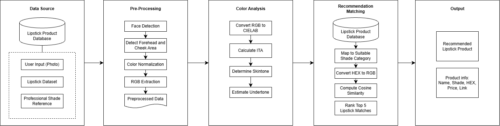

# LipMatchAI 

**Find Your Lipstick Match with a Photo**

LipMatch AI merupakan *prototype* aplikasi rekomendasi shade lipstik dari brand Indonesia berdasarkan warna kulit yang tertangkap pada foto wajah. Pengguna dapat mengunggah foto atau menggunakan kamera, melihat hasil analisis warna, memperoleh rekomendasi produk, dan mencoba tampilan warna lipstik secara virtual (*virtual try-on*).

Proyek ini dikembangkan sebagai **Final Project Hacktiv8 – FTDS-059 RMT & FTDS-044 HCK, Group 001**.

## Daftar Isi

1. [Latar Belakang](#1-latar-belakang)
2. [Tujuan Project](#2-tujuan-project)
3. [Dataset](#3-dataset)
4. [Metodologi dan Alur Aplikasi](#4-metodologi-dan-alur-aplikasi)
5. [Fitur Aplikasi](#5-fitur-aplikasi)
6. [Tech Stack](#6-tech-stack)
7. [Struktur Repository](#7-struktur-repository)
8. [Cara Menjalankan Aplikasi](#8-cara-menjalankan-aplikasi)
9. [Data Pipeline dan EDA](#9-data-pipeline-dan-eda)
10. [Keterbatasan dan Pengembangan](#10-keterbatasan-dan-pengembangan)
11. [Tim Project](#11-tim-project)

## 1. Latar Belakang

Pemilihan shade lipstik secara online dapat menjadi tantangan karena banyaknya variasi produk dan perbedaan tampilan warna pada kulit setiap pengguna. Foto produk dan deskripsi shade juga belum tentu menggambarkan hasil ketika lipstik digunakan secara langsung.

LipMatch AI dikembangkan untuk membantu pengguna mempersempit pilihan shade melalui analisis warna kulit dari foto dan pencocokan warna secara komputasional. Aplikasi juga menyediakan simulasi warna pada bibir agar pengguna dapat membandingkan beberapa pilihan sebelum mengunjungi halaman produk.

> **Catatan:** LipMatch AI masih berupa prototype, bukan alat penentu undertone yang telah tervalidasi secara profesional maupun jaminan kesesuaian warna produk saat digunakan.

## 2. Tujuan Project

- Membantu pengguna mengeksplorasi pilihan shade lipstik secara lebih personal berdasarkan foto wajah.
- Menyajikan rekomendasi produk dari katalog brand kosmetik Indonesia dengan metode **Cosine Similarity**.
- Menampilkan informasi produk dan simulasi **virtual try-on** untuk memudahkan perbandingan shade.
- Mengembangkan alur pengolahan data produk, analisis data, dan aplikasi berbasis **Streamlit**.

Dalam dokumen proposal, project juga mengusulkan evaluasi bisnis terkait *shade mismatch*, kepercayaan pengguna, dan retur produk. Angka target pada proposal merupakan **asumsi/simulasi bisnis**, bukan hasil pengukuran performa aplikasi yang sudah terbukti.

## 3. Dataset

**Nama dataset:** Indonesian Lipstick Product Dataset  
**Sumber:** pengumpulan data melalui *web scraping* halaman produk dari lima brand kosmetik Indonesia.  
**Tanggal pengumpulan yang dicantumkan dalam proposal:** 20 Oktober 2026.  
**Ukuran:** 226 baris dan 6 kolom; satu baris mewakili satu varian shade.

| Brand | Jumlah shade |
|---|---:|
| Wardah | 72 |
| BLP Beauty | 51 |
| Implora | 46 |
| SOMETHINC | 42 |
| MAKE OVER | 15 |
| **Total** | **226** |

### Data Dictionary

| Kolom pada `dataset.csv` | Deskripsi |
|---|---|
| `Nama Produk` | Nama produk lipstik |
| `Varian Warna` | Nama shade atau varian |
| `Hex Code` | Representasi warna shade dalam format HEX |
| `Harga` | Harga produk dalam format teks Rupiah |
| `Deskripsi` | Keterangan karakteristik warna atau produk |
| `Link Produk` | Tautan menuju halaman produk |

Repository menyimpan dua bentuk dataset:

- `dataset.csv`: data katalog awal, dengan nama kolom sesuai tabel di atas dan harga dalam format teks.
- `dataset_clean.csv`: data hasil pembersihan, dengan nama kolom *snake_case* dan `harga` numerik.

Pemeriksaan pada kedua file di repository menunjukkan **226 baris**, tanpa nilai kosong dan tanpa duplikasi baris secara keseluruhan. Data produk tetap perlu diverifikasi ulang apabila harga, ketersediaan, atau informasi shade pada website sumber berubah.

**Penggunaan data:** informasi produk dapat diakses melalui website brand, tetapi akses publik tidak otomatis berarti data berlisensi *public domain*. Perhatikan ketentuan penggunaan dari masing-masing sumber sebelum pendistribusian atau penggunaan komersial.

## 4. Metodologi dan Alur Aplikasi
<p align="center">
  
</p>

### Tahap Analisis

1. **Face detection:** MediaPipe Face Landmarker mendeteksi titik wajah pada foto pengguna.
2. **Ekstraksi warna kulit:** sistem mengambil sampel piksel pada area pipi kiri, pipi kanan, dan dahi, kemudian menghitung median RGB.
3. **Konversi warna:** nilai RGB dikonversi menjadi **CIELAB** untuk menyediakan komponen `L*`, `a*`, dan `b*`.
4. **Estimasi kategori:** aplikasi menggunakan selisih `b* - a*` sebagai aturan heuristik untuk menampilkan kategori `Warm`, `Cool`, atau `Neutral`. Aturan ini **bukan ambang ilmiah yang telah divalidasi** untuk mengidentifikasi undertone pengguna.
5. **Pengelompokan katalog:** shade produk dikelompokkan ke `Warm`, `Cool`, dan `Neutral` berdasarkan kata kunci pada nama/deskripsi, dengan fallback berbasis warna HSV.
6. **Rekomendasi:** warna HEX katalog dikonversi ke RGB, kemudian **Cosine Similarity pada vektor RGB** digunakan untuk mengurutkan produk. Aplikasi mengambil **3 shade teratas pada setiap kategori katalog**, sehingga totalnya hingga 9 rekomendasi.
7. **Virtual try-on:** landmark bibir dipakai untuk membuat mask, lalu warna shade diterapkan pada area bibir dengan pencampuran kanal warna LAB dan intensitas yang dapat diatur.

## 5. Fitur Aplikasi

- **Upload foto / kamera:** mendukung input foto dari galeri (`JPG`, `JPEG`, `PNG`, `WEBP`) atau kamera perangkat.
- **Deteksi wajah otomatis:** identifikasi landmark wajah dengan MediaPipe.
- **Analisis warna kulit:** preview titik sampling, warna HEX, nilai RGB/CIELAB, dan estimasi Warm/Cool/Neutral.
- **Rekomendasi lipstik:** hingga 9 rekomendasi yang terbagi dalam kategori Warm, Cool, dan Neutral.
- **Kartu produk:** nama produk, shade, harga, deskripsi, HEX, skor similarity, dan link produk.
- **Virtual try-on:** simulasi penerapan warna pada bibir untuk setiap shade yang direkomendasikan.
- **Pengaturan intensitas warna:** slider untuk mengatur kekuatan efek virtual try-on.

Skor Cosine Similarity merupakan ukuran kemiripan vektor RGB, **bukan probabilitas kecocokan lipstik** maupun prediksi kepuasan pengguna.

## 6. Tech Stack

| Komponen | Teknologi | Penggunaan |
|---|---|---|
| Bahasa pemrograman | Python | Pengolahan data dan aplikasi |
| Antarmuka | Streamlit | Aplikasi web interaktif |
| Computer vision | MediaPipe, OpenCV | Landmark wajah, mask bibir, virtual try-on |
| Analisis citra/warna | NumPy, Pillow, scikit-image | Pemrosesan RGB, HEX, dan CIELAB |
| Pengolahan data | Pandas | Membaca, membersihkan, dan mengurutkan katalog |
| EDA | Matplotlib, Seaborn | Eksplorasi data pada notebook |
| Data pipeline (terpisah) | Apache Airflow, PostgreSQL, Elasticsearch | Rancangan proses extract-transform-load |
| Data quality (konfigurasi) | Great Expectations | Folder konfigurasi `gx/` |

Implementasi rekomendasi memakai perhitungan kesamaan warna dan aturan heuristik; project **tidak melatih model CNN klasifikasi skin tone sendiri**. MediaPipe menggunakan model landmark wajah yang telah tersedia.

## 7. Struktur Repository

```text
Final-Project-FTDS-059-RMT-and-FTDS-044-HCK-Group-001/
├── README.md                         # Dokumentasi utama project
├── dataset.csv                       # Dataset katalog asli
├── dataset_clean.csv                 # Dataset hasil cleaning
├── DDL.txt                           # Definisi tabel PostgreSQL
├── final_project_DAG.py              # DAG ETL Airflow
├── eda.ipynb                         # Exploratory Data Analysis
├── LipMatch_AI.ipynb                 # Eksperimen analisis warna & rekomendasi
├── Final Project_Brainstorming.pdf   # Proposal dan business understanding
├── gx/                               # Konfigurasi Great Expectations
└── images/
    ├── application_workflow.png      # workflow aplikasi
└── lipmatch_ai_streamlit/
    ├── app.py                        # Aplikasi utama
    ├── dataset.csv                   # Katalog yang dibaca aplikasi
    ├── logo.png                      # Logo aplikasi
    ├── eda.ipynb                     # Notebook EDA tambahan
    ├── requirements.txt              # Dependency aplikasi
    └── README.md                     # Panduan singkat aplikasi
```

## 8. Cara Menjalankan Aplikasi

**Prasyarat:** Python 3.11 disarankan, koneksi internet untuk instalasi dependency, serta akses internet pada pemakaian pertama apabila model MediaPipe belum tersimpan.

### 8.1 Clone atau Ekstrak Repository

Jika project diperoleh sebagai ZIP, ekstrak folder terlebih dahulu. Buka terminal di folder utama project, lalu masuk ke folder aplikasi:

```bash
cd lipmatch_ai_streamlit
```

### 8.2 Buat Virtual Environment

```bash
python -m venv .venv
```

Aktivasi pada **Windows PowerShell**:

```powershell
.\.venv\Scripts\Activate.ps1
```

Atau pada **Windows Command Prompt**:

```bat
.venv\Scripts\activate.bat
```

Pada **macOS/Linux**:

```bash
source .venv/bin/activate
```

### 8.3 Instalasi Dependency

```bash
python -m pip install --upgrade pip
python -m pip install -r requirements.txt
```

### 8.4 Jalankan Streamlit

```bash
python -m streamlit run app.py
```

Buka alamat lokal yang ditampilkan pada terminal, umumnya `http://localhost:8501`.

### 8.5 Penggunaan

1. Pilih **Upload dari galeri** atau **Gunakan kamera**.
2. Masukkan foto wajah yang frontal, terang, dan tidak menggunakan filter warna.
3. Klik **Analyze & Predict**.
4. Periksa estimasi warna kulit dan daftar rekomendasi.
5. Bandingkan hasil **virtual try-on**, atur intensitas warna, dan gunakan link produk untuk melihat informasi lebih lanjut.

**Tips foto:** hindari makeup tebal pada pipi/dahi, usahakan pencahayaan putih merata, dan pastikan wajah serta bibir terlihat jelas.

Jika model wajah belum tersedia, aplikasi akan mengunduh `face_landmarker.task` pada pemakaian pertama. Alternatifnya, model dapat disimpan di `lipmatch_ai_streamlit/models/face_landmarker.task` agar digunakan secara lokal.

## 9. Data Pipeline dan EDA

### Data Engineering

Repository juga memiliki rancangan pipeline pada `final_project_DAG.py`:

```text
PostgreSQL (tabel produk_lipstick)
           ↓ Extract
        sqldata.csv
           ↓ Transform (drop duplicates, parsing harga)
     dataset_clean.csv
           ↓ Load
Elasticsearch (index: lipmatch)
```

- `DDL.txt`: definisi tabel sumber `produk_lipstick`.
- `final_project_DAG.py`: tugas `select` → `clean` → `load` untuk Airflow; konfigurasi jadwal pada script adalah mingguan.
- `gx/`: berisi konfigurasi Great Expectations; **DAG yang tersedia belum memanggil validasi Great Expectations secara langsung**.
- `eda.ipynb`: eksplorasi distribusi brand, harga, dan jumlah varian produk.

**Status integrasi:** pipeline Airflow–PostgreSQL–Elasticsearch merupakan komponen terpisah. **Aplikasi Streamlit saat ini membaca `lipmatch_ai_streamlit/dataset.csv` secara lokal**, bukan menarik data secara langsung dari PostgreSQL maupun Elasticsearch. Menjalankan aplikasi Streamlit **tidak memerlukan** tiga layanan tersebut. Untuk menjalankan DAG, dibutuhkan instalasi dan konfigurasi layanan terkait; berkas orkestrasi/deployment layanan tidak disertakan dalam repository ini.

Notebook `LipMatch_AI.ipynb` digunakan sebagai eksperimen terkait analisis warna, rekomendasi, dan virtual try-on. Untuk memastikan dokumentasi sesuai perilaku aplikasi yang digunakan, **`lipmatch_ai_streamlit/app.py` menjadi acuan implementasi Streamlit** apabila metode dalam notebook berbeda.

## 10. Keterbatasan dan Pengembangan

**Keterbatasan saat ini:**

- Hasil estimasi warna dipengaruhi pencahayaan, jenis kamera, makeup, dan kualitas foto.
- Pengelompokan undertone dan shade menggunakan heuristik, belum divalidasi oleh ahli makeup atau melalui pengujian pengguna yang memadai.
- Cosine Similarity RGB mengukur kemiripan numerik, bukan persepsi kecocokan kosmetik pada kulit atau bibir.
- Virtual try-on bersifat simulasi digital; hasil warna produk nyata dapat berbeda karena pigmentasi bibir, tekstur lipstik, dan pencahayaan.
- Dataset mencakup katalog terbatas dan dapat menjadi tidak mutakhir seiring perubahan harga, shade, atau link produk.
- Tidak terdapat evaluasi kuantitatif yang membuktikan peningkatan confidence, penurunan retur, atau akurasi kesesuaian shade.

**Rencana pengembangan:** validasi kategori warna bersama ahli, uji pengalaman pengguna, perluasan katalog, evaluasi perbandingan warna yang lebih sesuai persepsi visual, serta integrasi data pipeline dengan aplikasi.

**Privasi:** kode aplikasi saat ini memproses foto dalam sesi dan tidak menuliskannya sebagai file secara sengaja. Apabila aplikasi dipublikasikan, pengelola tetap perlu memeriksa kebijakan penyimpanan data, log, dan privasi pada platform hosting.

## 11. Tim Project

**Hacktiv8 Final Project — FTDS-059 RMT & FTDS-044 HCK, Group 001**

- Amanda Amalia Putriprayogi
- Angelina Yessyca Rahardjo Hadi
- Syauqiya Hasna
- Bara Samudra Syuhada
- Fauzan Abdurrochman Anwar

---

*LipMatch AI — membantu eksplorasi pilihan shade lipstik secara visual dan berbasis data.*
